<div align="center">
  
</div>
<p align="center">
  
</p>

<p align="center">
  <a href="https://github.com/rohitam26">
    
  </a>
  <a href="https://www.linkedin.com/in/rohita-muthu-a67b0332a">
    
  </a>
  <a href="mailto:rohitam256@gmail.com">
    
  </a>
  
  
  
</p>

---

## 🧠 About Me


```python
class Rohita:
    def __init__(self):
        self.name         = "Rohita Muthu"
        self.role         = "AI/ML Engineering Student & Developer"
        self.location     = "Chennai, Tamil Nadu 🇮🇳"
        self.degree       = "B.Tech – AI & ML @ REC, Chennai"
        self.email        = "rohitam256@gmail.com"
        self.public_repos = 17

        self.stack = [
            "Python", "Java", "C", "Dart", "SQL", "JavaScript",
            "PyTorch", "TensorFlow", "Scikit-Learn",
            "FastAPI", "Flask", "Flutter", "React",
            "NumPy", "Pandas", "Matplotlib", "Seaborn",
            "PostgreSQL", "SQLite", "MySQL", "MongoDB", "Docker"
        ]

        self.currently_learning = [
            "Deep Learning & Vision Architectures",
            "Generative AI & RAG Pipelines",
            "Distributed Systems & Saga Orchestration",
            "Applied AI & Full-Stack Intelligence",
            "Cloud Infrastructure & Containerization"
        ]

        self.fun_fact = "Built StockGuard to solve flash-sale inventory contention! ⚡"

    def motto(self):
        return "Innovate. Code. Solve. Elevate. 🚀"
```

<br clear="right"/>

---

## 🛠️ Tech Stack & Tools

### 💻 Languages


### 🤖 AI / ML Frameworks & Libraries


### 🤖 Agentic AI & GenAI


### 🌐 Frameworks & Frontend


### ☁️ Cloud & DevOps


### 🗄️ Databases & Data Sources


### 🔧 Tools


---

## 📊 GitHub Stats

<div align="center">
  
  &nbsp;
  
</div>

---

## 🔥 Streak Stats

<div align="center">
  
</div>

---

## 🐉 Contribution Graph

<div align="center">
  <picture>
    <source media="(prefers-color-scheme: dark)" srcset="https://raw.githubusercontent.com/rohitam26/rohitam26/output/github-contribution-grid-dragon-dark.svg">
    <source media="(prefers-color-scheme: light)" srcset="https://raw.githubusercontent.com/rohitam26/rohitam26/output/github-contribution-grid-dragon.svg">
    
  </picture>
</div>

---

## 📈 Activity Graph

<div align="center">
  
</div>

---

## 🏆 Trophy Wall
<div align="center">
  
</div>

---

## 🚀 Featured Projects

<div align="center">

| 🗂️ Project | 🛠️ Stack | ✨ Highlights & Metrics |
|:---|:---|:---|
| [⚡ **StockGuard**](https://github.com/rohitam26/stockguard) | Python · FastAPI · PostgreSQL · Docker | Distributed reservations · Saga pattern · ACID compliance |
| [🧭 **YatraSaathi**](https://github.com/rohitam26/YatraSaathi) | Flutter · Dart · Android Location · Notifications | Multi-stop GPS tracking · Proximity arrival alarms · 90/90 tests |
| [💑 **Geh-reDir (Twogether)**](https://github.com/rohitam26/Geh-reDir) | HTML5 · CSS3 · Modern JavaScript | Aesthetic shared couples space · Expense split · Joint calendar |
| [🧠 **Deep Learning Lab**](https://github.com/rohitam26/Deep-Learning-Laboratory) | Python · PyTorch · TensorFlow · Vision & NLP | CNN, RNN, LSTM architectures · Medical & vision datasets |
| [🤖 **Foundations of ML Lab**](https://github.com/rohitam26/Foundations-of-Machine-Learning-Laboratory) | Python · Scikit-Learn · NumPy · Pandas | Supervised & unsupervised learning · Ensemble classifiers · PCA |
| [☁️ **Zoho Creator Low-Code**](https://github.com/rohitam26/Low-Code-Application-Development-using-Zoho-Creator) | Deluge · Zoho Creator Cloud Platform | Coursework planner · Automated milestone tracking · RBAC |
| [🌐 **Web & Mobile Apps Lab**](https://github.com/rohitam26/Web-Technology-and-Mobile-Applications-Laboratory) | React 19 · Vite · Java Servlets · Android | Client portals · Servlets · Mobile components · SPAs |
| [🖥️ **Operating Systems Lab**](https://github.com/rohitam26/Operating-Systems-Laboratory) | C · POSIX · Linux Shell | Process scheduling · IPC synchronization · Memory virtualization |
| [📡 **Computer Networks Lab**](https://github.com/rohitam26/Computer-Networks-Laboratory) | Python · C · Wireshark · Packet Tracer | Socket programming · RIP routing · Raw packet sniffing |
| [🔍 **Principles of AI Lab**](https://github.com/rohitam26/Principles-Of-Artificial-Intelligence-Laboratory) | Python · Prolog · Heuristic Search | A*, Minimax, CSP, Knowledge representation & fuzzy logic |

</div>

---

## 📂 All Repositories

<!-- PROJECTS:START -->
| Repository | Description | Primary Language |
| :--- | :--- | :--- |
| [**stockguard**](https://github.com/rohitam26/stockguard) | Enterprise Distributed Inventory Intelligence, Atomic Reservations & Saga Orchestration Engine. | Python |
| [**YatraSaathi**](https://github.com/rohitam26/YatraSaathi) | Location-aware journey companion with multi-stop GPS tracking, proximity arrival alarms, and safety check-ins built with Flutter. | Dart |
| [**Geh-reDir**](https://github.com/rohitam26/Geh-reDir) | Twogether (GehöreDir) — An elegant, aesthetic shared space web application for couples featuring shared expenses, savings, joint calendar, to-dos, and life goals. | HTML |
| [**Deep-Learning-Laboratory**](https://github.com/rohitam26/Deep-Learning-Laboratory) | Deep Learning laboratory experiments and mini-projects in PyTorch & TensorFlow across computer vision, NLP, and medical imaging. | Jupyter Notebook |
| [**Foundations-of-Machine-Learning-Laboratory**](https://github.com/rohitam26/Foundations-of-Machine-Learning-Laboratory) | Supervised, unsupervised, ensemble learning, and dimensionality reduction implementations with Scikit-learn and Python. | Python |
| [**Principles-Of-Artificial-Intelligence-Laboratory**](https://github.com/rohitam26/Principles-Of-Artificial-Intelligence-Laboratory) | Classical AI algorithms covering heuristic search (A*, Minimax), CSP, knowledge representation, fuzzy logic, and Prolog. | Python |
| [**Data-Analytics-and-Visualization-Laboratory**](https://github.com/rohitam26/Data-Analytics-and-Visualization-Laboratory) | Exploratory data analysis, statistical data wrangling, and multi-variable visual dashboards using Pandas and Seaborn. | Jupyter Notebook |
| [**Database-Management-Systems-Laboratory**](https://github.com/rohitam26/Database-Management-Systems-Laboratory) | Relational schema design, advanced SQL, PL/SQL programmability, database triggers, and NoSQL MongoDB administration. | SQL |
| [**Operating-Systems-Laboratory**](https://github.com/rohitam26/Operating-Systems-Laboratory) | Operating system concepts, POSIX system calls, process scheduling, inter-process communication (IPC), and memory management in C. | C, Shell |
| [**Computer-Networks-Laboratory**](https://github.com/rohitam26/Computer-Networks-Laboratory) | Protocol engineering, socket programming, network layer routing, and packet inspection across OSI & TCP/IP layers. | Python, C |
| [**Design-and-Analysis-of-Algorithms-Laboratory**](https://github.com/rohitam26/Design-and-Analysis-of-Algorithms-Laboratory) | Comprehensive algorithmic design paradigms, asymptotic analysis, dynamic programming, greedy strategies, and graph algorithms in C. | C |
| [**Object-Oriented-Programming-with-Java-Laboratory**](https://github.com/rohitam26/Object-Oriented-Programming-with-Java-Laboratory) | Core OOP principles, modern Java collections framework, exception handling, multithreading, and JDBC database applications. | Java |
| [**C-Programming-Laboratory**](https://github.com/rohitam26/C-Programming-Laboratory) | Comprehensive C Programming Laboratory records and coursework covering fundamental to advanced programming concepts spanning 16 weeks of experiments. | C |
| [**Python-Programming-Laboratory**](https://github.com/rohitam26/Python-Programming-Laboratory) | Python programming curriculum covering core syntax, data structures, functional paradigms, file I/O, and NumPy vectorized computing. | Python |
| [**Web-Technology-and-Mobile-Applications-Laboratory**](https://github.com/rohitam26/Web-Technology-and-Mobile-Applications-Laboratory) | Client-side web interfaces, Java servlets, Android mobile components, and interactive React 19 single-page applications. | HTML, React |
| [**Low-Code-Application-Development-using-Zoho-Creator**](https://github.com/rohitam26/Low-Code-Application-Development-using-Zoho-Creator) | Academic coursework planner and milestone tracking application built on the Zoho Creator cloud platform. | Deluge |
| [**rohitam26**](https://github.com/rohitam26/rohitam26) | Personal GitHub Profile repository with automated contribution tracking and mythical azure dragon runner animation. | Markdown, Workflow |
<!-- PROJECTS:END -->

---

## 🎖️ Achievements & Academic Highlights

<div align="center">

| 🏅 | Milestone | Details |
|:---:|:---|:---|
| 🎓 | **Pre-Final Year AIML Undergraduate** | Rajalakshmi Engineering College — Specialized in Applied AI, Deep Learning & Intelligent Systems |
| ⚡ | **StockGuard Distributed Engine** | Engineered distributed reservation engine with Saga compensation and zero-oversell guarantee |
| 📱 | **YatraSaathi Mobile Platform** | Built full-featured Flutter app with multi-stop GPS tracking and 90/90 unit & widget test coverage |
| 💑 | **Twogether (GehöreDir) App** | Architected shared life and financial management web application for couples |
| 🧠 | **Deep Learning Laboratory** | Comprehensive PyTorch & TensorFlow implementations covering CNNs, RNNs, and transfer learning |
| 🤖 | **Foundations of Machine Learning** | End-to-end ML algorithms, supervised classification/regression, ensemble modeling, and PCA |
| 📊 | **Data Analytics & Visualization** | In-depth EDA pipelines, wrangling, and interactive multi-variable visual dashboards in Python |
| ☁️ | **Zoho Creator Cloud Engineering** | End-to-end low-code cloud architecture with complex Deluge automation workflows and RBAC |
| 🗄️ | **Relational & NoSQL Database Systems** | Advanced SQL, PL/SQL stored procedures, triggers, and document-oriented MongoDB querying |
| 🖥️ | **Operating Systems & Systems Programming** | POSIX system call implementations, synchronization primitives, and custom CPU schedulers in C |
| 📡 | **Computer Networks & Routing Protocols** | Socket programming, dynamic RIP routing, Cisco Packet Tracer simulations, and packet inspection |

</div>

---

## 🎓 Education & Currently Learning

### 🏛️ Education

<div align="center">

| 🎓 Degree | 🏫 Institution | 📅 Year | 📊 Status |
|:---|:---|:---|:---|
| B.Tech – Artificial Intelligence & Machine Learning | Rajalakshmi Engineering College, Chennai | Pre-Final Year | In Progress |

</div>

### 🧱 Currently Learning

```
🤖 Agentic AI      → Multi-Agent Systems, Tool Use, LangGraph, LLM Workflows
🧱 Generative AI   → LLM Fine-Tuning, Prompt Engineering, RAG Pipelines
🔬 Deep Learning   → Vision Transformers, Convolutional Networks, Sequence Models
⚡ Distributed     → Atomic Reservations, Outbox Pattern, Saga Orchestration
📱 Mobile & AI     → Flutter Cross-Platform, Real-Time Location Tracking
🌐 Full-Stack AI   → FastAPI, Modern React, Single Page Architectures
```

---

<div align="center">
  
</div>
<p align="center">
  <i>⭐ If you find my work interesting, consider giving a star to my repos!</i><br/>
  <b>Let's connect and build something amazing together 🚀</b>
</p>
