<div align="center">
  
</div>
<p align="center">
  
</p>

<p align="center">
  <a href="https://github.com/rohitam26">
    
  </a>
  <a href="https://www.linkedin.com/in/rohita-muthu-a67b0332a">
    
  </a>
  <a href="mailto:rohitam256@gmail.com">
    
  </a>
  
  
</p>

---

## 🧠 About Me


```python
class Rohita:
    def __init__(self):
        self.name         = "Rohita Muthu"
        self.role         = "Design Lead @ IEEE CIS REC Chapter"
        self.location     = "Chennai, Tamil Nadu 🇮🇳"
        self.degree       = "B.Tech – AI & ML @ REC, Chennai"
        self.email        = "rohitam256@gmail.com"
        self.public_repos = 16

        self.stack = [
            "Python", "Java", "C", "Dart", "SQL", "JavaScript",
            "PyTorch", "TensorFlow", "Scikit-Learn",
            "FastAPI", "Flask", "Flutter", "React",
            "NumPy", "Pandas", "Matplotlib", "Seaborn",
            "PostgreSQL", "SQLite", "MySQL", "MongoDB", "Docker"
        ]

        self.currently_learning = [
            "Deep Learning & Vision Architectures",
            "Generative AI & RAG Pipelines",
            "Distributed Systems & Saga Orchestration",
            "Applied AI & Full-Stack Intelligence",
            "Cloud Infrastructure & Containerization"
        ]

        self.fun_fact = "Built StockGuard to solve flash-sale inventory contention! ⚡"

    def motto(self):
        return "Innovate. Code. Solve. Elevate. 🚀"
```

<br clear="right"/>

---

## 🛠️ Tech Stack & Tools

### 💻 Languages


### 🤖 AI / ML Frameworks & Libraries


### 🤖 Agentic AI & GenAI


### 🌐 Frameworks & Frontend


### ☁️ Cloud & DevOps


### 🗄️ Databases & Data Sources


### 🔧 Tools


---

## 📊 GitHub Stats

<div align="center">
  
  &nbsp;
  
</div>

---

## 🔥 Streak Stats

<div align="center">
  
</div>

---

## 🐱 Contribution Graph

<div align="center">
  <picture>
    <source media="(prefers-color-scheme: dark)" srcset="./github-metrics/github-contribution-grid-cat-dark.svg">
    <source media="(prefers-color-scheme: light)" srcset="./github-metrics/github-contribution-grid-cat.svg">
    
  </picture>
</div>

---

## 📈 Activity Graph

<div align="center">
  
</div>

<details>
<summary><b>✨ Preview All 6 Animation Effects (Click to Expand)</b></summary>
<br/>

#### 1. 🌠 Riding Comet Particle (`animateMotion` Traversing Peaks & Valleys)
<div align="center">
  
</div>

#### 2. 📡 Holographic Radar / Oscilloscope Scanner Beam
<div align="center">
  
</div>

#### 3. 🌌 Aurora Borealis Shifting Liquid Gradient
<div align="center">
  
</div>

#### 4. 👑 Peak Milestone Twinkling Stars (Summit Highlights)
<div align="center">
  
</div>

#### 5. 🌐 Cyberpunk Matrix Hologram Grid
<div align="center">
  
</div>

#### 6. ⚡ The Ultimate Fusion (All Effects Synchronized)
<div align="center">
  
</div>

</details>

---

## 🏆 Trophy Wall
<div align="center">
  
</div>

---

## 💼 Featured Work Experience

<details open>
<summary><b>🎨 Design Lead — IEEE CIS REC Chapter | Sep 2026 – Present</b></summary>

> `Visual Communication` `Creative Design` `UI/UX Branding` `Graphic Design` `Event Identity` `Leadership`

- 🎨 **Creative Leadership**: Leading the creative direction and visual design initiatives for the **IEEE Computational Intelligence Society (IEEE CIS)** Student Chapter at Rajalakshmi Engineering College.
- 📢 **Branding & Visual Identity**: Spearheading end-to-end visual communication, branding, typography, and media collaterals for society flagship events, technical workshops, symposiums, and national hackathons.
- 👥 **Team Coordination & Mentorship**: Guiding design workflows, establishing consistent chapter visual guidelines, and collaborating with technical committees to produce engaging digital media.
- 💎 **Core Competencies**: Visual Storytelling, Graphic Design, Brand Consistency, UI/UX Aesthetics, and Cross-Functional Event Execution.

</details>

<details>
<summary><b>⚡ StockGuard — Distributed Inventory Reservation & Order Reliability Engine</b></summary>

> `Python` `FastAPI` `PostgreSQL 16` `Docker` `Saga Pattern` `Transactional Outbox` `Idempotency`

- 🏗️ Engineered a high-throughput **distributed inventory reservation engine** designed to eliminate overselling during high-contention flash sales.
- 🔒 Implemented strict **ACID transactional isolation**, atomic conditional allocations (`UPDATE ... WHERE available >= requested`), and idempotent reservation validation.
- 🔄 Architected a **Transactional Outbox Event Pipeline** with backward-compensating **Saga Orchestration** for multi-step order checkout flows.
- 🧪 Achieved zero oversell under concurrent load tests, backed by comprehensive end-to-end integration and concurrency testing suites.

</details>

<details>
<summary><b>🧭 YatraSaathi — Location-Aware Journey Companion & Safety Alerts</b></summary>

> `Flutter 3` `Dart` `Android Location Services` `Background Geofencing` `Local Notifications`

- 📱 Developed a full-fledged cross-platform mobile journey companion for commuters with real-time GPS tracking and waypoint management.
- 📍 Engineered **multi-stop proximity arrival alarms** that trigger audio-haptic alerts upon entering customizable geofenced radii.
- 🛡️ Built automated **commuter safety check-ins** and emergency alert broadcasts to trusted contacts upon route deviations.
- 🧪 Maintained production-grade reliability with **90/90 passed automated unit and widget test cases**.

</details>

<details>
<summary><b>🔍 WorkloadLens — Automation Workload Estimation & Preview System</b></summary>

> `Python` `FastAPI` `React` `TypeScript` `SQLite` `Docker` `Terraform` `Pytest`

- 🏗️ Developed an automation workload estimation and preview platform for the **UC-05 Cloud & SaaS Engineering Challenge**.
- 📋 Implemented a deterministic validation engine enforcing **R1–R4 rule sets**, tenant authorization, and subscription quota limits.
- ⚡ Engineered an idempotent workload submission pipeline with deterministic execution time prediction (`record count × 10 ms`).
- 📊 Delivered a responsive React + TypeScript dashboard with interactive workload run inspection and state transition auditing.

</details>

<details>
<summary><b>🧠 Deep Learning Laboratory — Neural Architectures, Computer Vision & Medical Imaging</b></summary>

> `Python` `PyTorch 2.x` `TensorFlow` `CNN` `RNN` `LSTM` `Transfer Learning`

- 🔬 Implemented deep convolutional and recurrent architectures across computer vision, sequence analysis, and clinical diagnostic datasets.
- 🖼️ Trained and fine-tuned CNN classifiers for image classification and medical imaging segmentation with robust regularization.
- 📈 Evaluated performance across standard benchmark datasets with ROC-AUC, confusion matrices, and precision-recall trade-offs.

</details>

<details>
<summary><b>🤖 Foundations of Machine Learning — Supervised, Unsupervised & Ensemble Algorithms</b></summary>

> `Python` `Scikit-Learn` `NumPy` `Pandas` `Matplotlib` `Seaborn`

- 📊 Implemented end-to-end ML workflows: exploratory data analysis, feature engineering, cross-validation, and hyperparameter tuning.
- 🌲 Evaluated linear/logistic regression, decision trees, random forests, gradient boosting, SVMs, and k-means clustering.
- 📐 Formulated rigorous model evaluations with ablation studies and dimensionality reduction using Principal Component Analysis (PCA).

</details>

<details>
<summary><b>☁️ Low-Code Application Development — Zoho Creator Cloud Platform</b></summary>

> `Deluge Scripting` `Zoho Creator` `Cloud Architecture` `Workflow Automation` `RBAC`

- 🚀 Engineered an end-to-end academic coursework planner and milestone tracking application hosted on the Zoho Creator cloud platform.
- ⚙️ Authored complex **Deluge workflow scripts** for automated record updates, email notifications, and validation triggers.
- 👥 Configured granular role-based access control (RBAC), personalized dashboards, and interactive Kanban progress views.

</details>

<details>
<summary><b>🌐 Web Technology & Mobile Applications — Full-Stack & Native Android</b></summary>

> `React 19` `Vite` `Java Servlets` `Android` `REST APIs` `CSS3`

- 💻 Developed responsive web portals using modern semantic HTML5, CSS3, JavaScript, and a high-performance **React 19 + Vite** Single Page Application.
- ☕ Implemented server-side business logic and database interactions using **Java Servlets and JDBC**.
- 📱 Engineered native Android mobile application components with clean activity lifecycles and modern UI controls.

</details>

<details>
<summary><b>🖥️ Operating Systems — POSIX Systems Programming & Kernel Concepts</b></summary>

> `C` `POSIX APIs` `Process Scheduling` `IPC` `Memory Virtualization` `Shell`

- ⚙️ Implemented foundational operating systems algorithms in C: CPU scheduling (FCFS, SJF, Round Robin, Priority) and deadlock avoidance (Banker's Algorithm).
- 🔄 Developed inter-process communication (IPC) pipelines using UNIX pipes, shared memory, and message queues.
- 🛡️ Simulated memory management schemes including paging, segmentation, and page replacement policies (FIFO, LRU, Optimal).

</details>

---

## 🚀 Featured Projects

<div align="center">

| 🗂️ Project | 🛠️ Stack | ✨ Highlights & Metrics |
|:---|:---|:---|
| [⚡ StockGuard](https://github.com/rohitam26/stockguard) | Python · FastAPI · PostgreSQL · Docker | Distributed reservations · Saga pattern · ACID compliance |
| [🧭 YatraSaathi](https://github.com/rohitam26/YatraSaathi) | Flutter · Dart · Android Location · Notifications | Multi-stop GPS tracking · Proximity arrival alarms · 90/90 tests |
| [🔍 WorkloadLens](https://github.com/rohitam26/UC-05_automation-workload) | Python · FastAPI · React · SQLite · Docker | R1–R4 rule validation · Quota checking · Idempotency |
| [🧠 Deep Learning Lab](https://github.com/rohitam26/Deep-Learning-Laboratory) | Python · PyTorch · TensorFlow · Vision & NLP | CNN, RNN, LSTM architectures · Medical & vision datasets |
| [🤖 Foundations of ML Lab](https://github.com/rohitam26/Foundations-of-Machine-Learning-Laboratory) | Python · Scikit-Learn · NumPy · Pandas | Supervised & unsupervised learning · Ensemble classifiers · PCA |
| [☁️ Zoho Creator Low-Code](https://github.com/rohitam26/Low-Code-Application-Development-using-Zoho-Creator) | Deluge · Zoho Creator Cloud Platform | Coursework planner · Automated milestone tracking · RBAC |
| [🌐 Web & Mobile Apps Lab](https://github.com/rohitam26/Web-Technology-and-Mobile-Applications-Laboratory) | React 19 · Vite · Java Servlets · Android | Client portals · Servlets · Mobile components · SPAs |
| [🖥️ Operating Systems Lab](https://github.com/rohitam26/Operating-Systems-Laboratory) | C · POSIX · Linux Shell | Process scheduling · IPC synchronization · Memory virtualization |
| [📡 Computer Networks Lab](https://github.com/rohitam26/Computer-Networks-Laboratory) | Python · C · Wireshark · Packet Tracer | Socket programming · RIP routing · Raw packet sniffing |

</div>

---

## 📂 All Repositories

<!-- PROJECTS:START -->
| Repository | Description | Primary Language |
| :--- | :--- | :--- |
| [**C-Programming-Laboratory**](https://github.com/rohitam26/C-Programming-Laboratory) | Comprehensive C Programming Laboratory records and coursework covering fundamental to advanced programming concepts spanning 16 weeks of experiments. | Documentation |
| [**Web-Technology-and-Mobile-Applications-Laboratory**](https://github.com/rohitam26/Web-Technology-and-Mobile-Applications-Laboratory) | Client-side web interfaces, Java servlets, Android mobile components, and interactive web application experiments. | HTML, CSS |
| [**Python-Programming-Laboratory**](https://github.com/rohitam26/Python-Programming-Laboratory) | Core syntax, data structures, recursion, file operations, and vectorized numerical computing using Python. | Python |
| [**Principles-Of-Artificial-Intelligence-Laboratory**](https://github.com/rohitam26/Principles-Of-Artificial-Intelligence-Laboratory) | Classical AI algorithms covering heuristic search, constraint satisfaction, game trees, fuzzy logic, and Prolog. | Python, Prolog |
| [**Operating-Systems-Laboratory**](https://github.com/rohitam26/Operating-Systems-Laboratory) | System programming, process scheduling, inter-process communication, and memory virtualization laboratory implementations in C. | C, Shell |
| [**Object-Oriented-Programming-with-Java-Laboratory**](https://github.com/rohitam26/Object-Oriented-Programming-with-Java-Laboratory) | Core object-oriented programming principles, modern Java collections, exception handling, and JDBC database applications. | Java |
| [**Low-Code-Application-Development-using-Zoho-Creator**](https://github.com/rohitam26/Low-Code-Application-Development-using-Zoho-Creator) | Academic coursework planner and milestone tracking application built on the Zoho Creator cloud platform. | Deluge |
| [**Foundations-of-Machine-Learning-Laboratory**](https://github.com/rohitam26/Foundations-of-Machine-Learning-Laboratory) | Supervised and unsupervised learning algorithms, regression models, ensemble classifiers, and dimensionality reduction in Python. | Python |
<!-- PROJECTS:END -->

---

## 🎖️ Achievements & Certifications

<div align="center">

| 🏅 | Achievement | Details |
|:---:|:---|:---|
| 🎨 | **Design Lead — IEEE CIS REC Chapter** | Spearheading creative direction, branding, and visual communication for society events & workshops |
| ⚡ | **StockGuard Distributed Engine** | Engineered distributed reservation engine with Saga compensation and zero-oversell guarantee |
| 📱 | **YatraSaathi Mobile Platform** | Built full-featured Flutter app with multi-stop GPS tracking and 90/90 unit & widget test coverage |
| 🔍 | **UC-05 Automation Workload Challenge** | Architected deterministic workload estimation engine with R1–R4 rule validation and quotas |
| 🧠 | **Deep Learning Laboratory** | Comprehensive PyTorch & TensorFlow implementations covering CNNs, RNNs, and transfer learning |
| 🤖 | **Foundations of Machine Learning** | End-to-end ML algorithms, supervised classification/regression, ensemble modeling, and PCA |
| 📊 | **Data Analytics & Visualization** | In-depth EDA pipelines, wrangling, and PowerBI-equivalent executive visual dashboards in Python |
| ☁️ | **Zoho Creator Cloud Engineering** | End-to-end low-code cloud architecture with complex Deluge automation workflows and RBAC |
| 🗄️ | **Relational & NoSQL Database Systems** | Advanced SQL, PL/SQL stored procedures, triggers, and document-oriented MongoDB querying |
| 🖥️ | **Operating Systems & Systems Programming** | POSIX system call implementations, synchronization primitives, and custom CPU schedulers in C |
| 📡 | **Computer Networks & Routing Protocols** | Socket programming, dynamic RIP routing, Cisco Packet Tracer simulations, and packet inspection |

</div>

---

## 🎓 Education & Currently Learning

### 🏛️ Education

<div align="center">

| 🎓 Degree | 🏫 Institution | 📅 Year | 📊 Score |
|:---|:---|:---|:---|
| B.Tech – Artificial Intelligence & Machine Learning | Rajalakshmi Engineering College, Chennai | Pre-Final Year | In Progress |

</div>

### 🧱 Currently Learning

```
🤖 Agentic AI      → Multi-Agent Systems, Tool Use, LangGraph, LLM Workflows
🧱 Generative AI   → LLM Fine-Tuning, Prompt Engineering, RAG Pipelines
🔬 Deep Learning   → Vision Transformers, Convolutional Networks, Sequence Models
⚡ Distributed     → Atomic Reservations, Outbox Pattern, Saga Orchestration
📱 Mobile & AI     → Flutter Cross-Platform, Real-Time Location Tracking
🌐 Full-Stack AI   → FastAPI, Modern React, Single Page Architectures
```

---

<div align="center">
  
</div>
<p align="center">
  <i>⭐ If you find my work interesting, consider giving a star to my repos!</i><br/>
  <b>Let's connect and build something amazing together 🚀</b>
</p>
